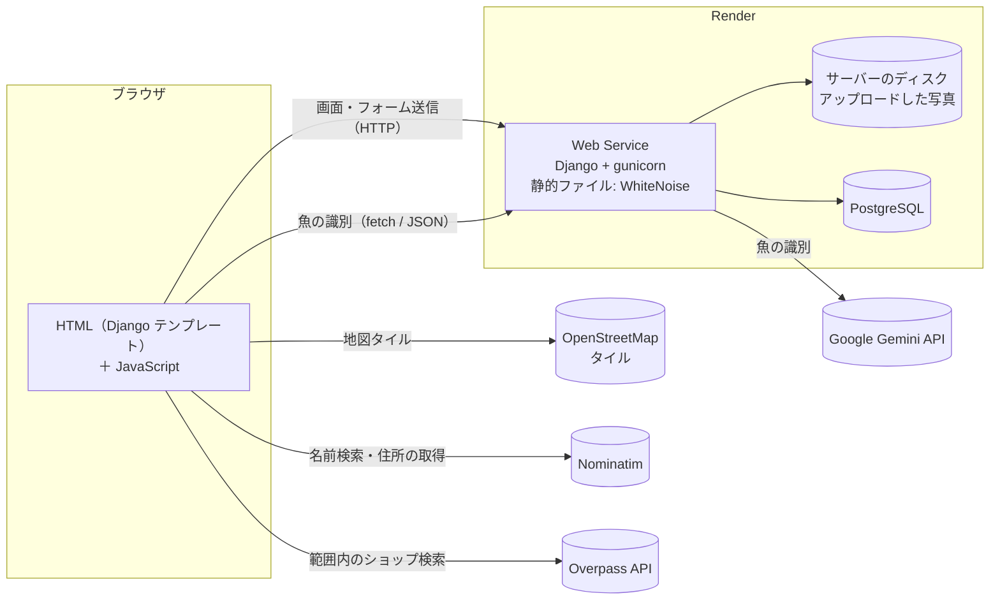
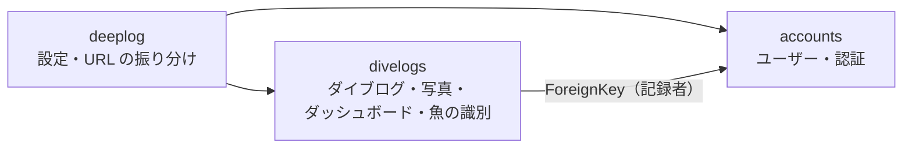
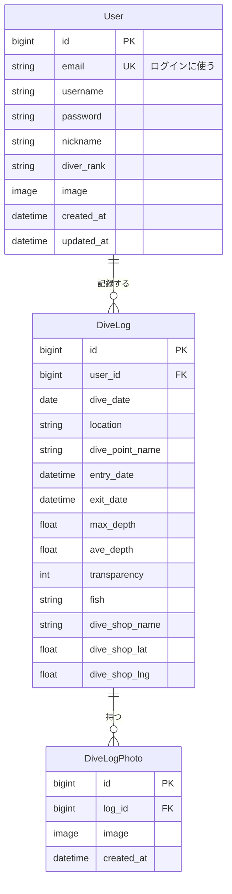
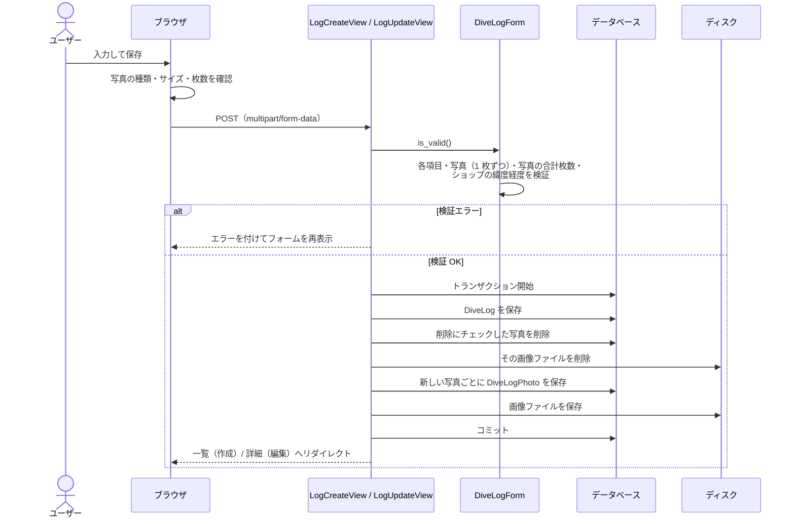
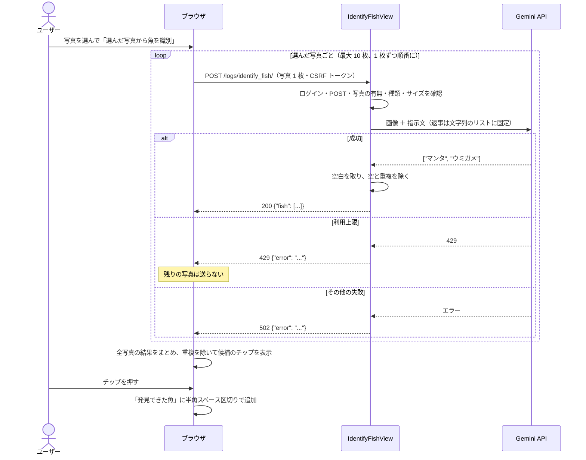
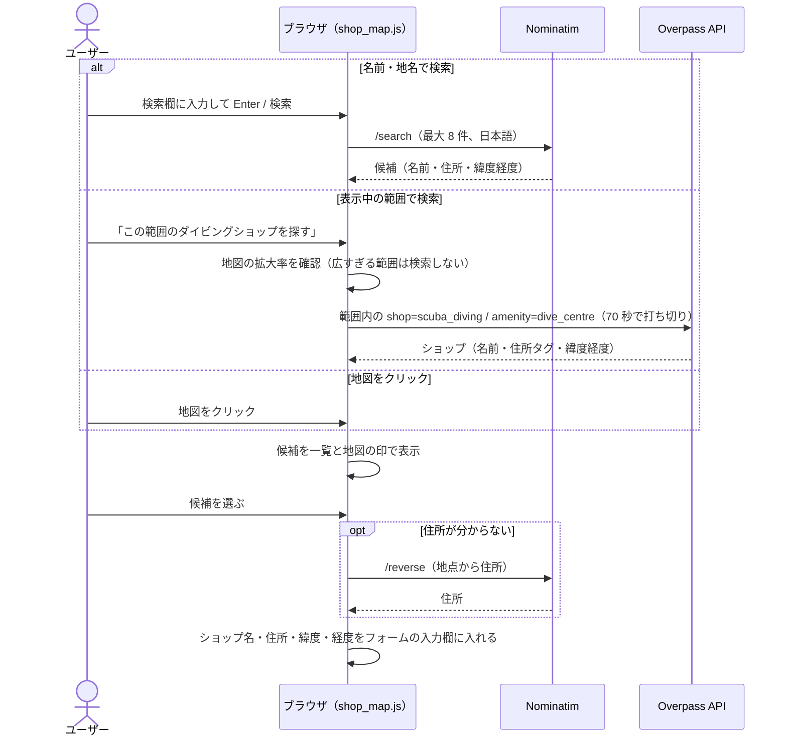
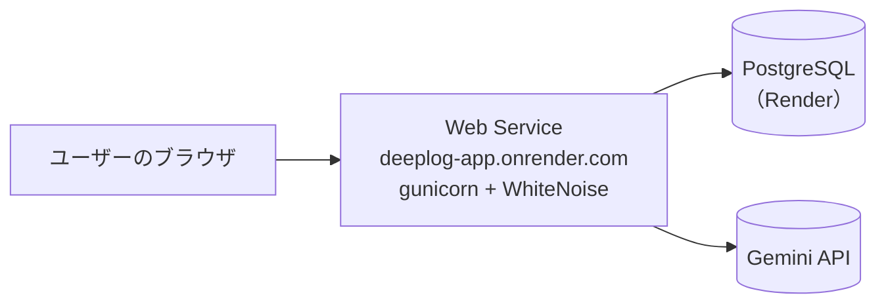

# DEEPLOG 設計書

> **要約**
> - Django 5.2 のサーバーサイドレンダリング（SSR）で作った Web アプリ。画面は Django テンプレートで生成し、地図・グラフ・写真のプレビューなど画面上の操作だけを JavaScript で補う。Render の Web Service（gunicorn + WhiteNoise）と PostgreSQL で公開している。
> - データは「ユーザー → ダイブログ → 写真」の 1 対多の 3 つのモデル。写真は複数枚を持てるよう別のテーブル（`DiveLogPhoto`）に分け、ダイビングショップは地図で選んだ名前・住所・緯度・経度をダイブログに直接持つ。
> - 外部サービスは、魚の識別（Google Gemini API）だけをサーバーから呼び、API キーをブラウザに渡さない。地図（OpenStreetMap）とショップの検索（Nominatim・Overpass API）は API キーが不要なので、ブラウザから直接呼ぶ。

- 関連文書：[要件定義書](requirements.md)

---

## 1. システム構成

### 1.1 全体構成



- 画面は Django がサーバーで HTML を生成して返す。フォームの送信・検証・保存もサーバーで行う。
- **Gemini API だけはサーバーから呼ぶ**。API キーをブラウザに渡さないため。
- **地図とショップの検索はブラウザから直接呼ぶ**。API キーが不要で、サーバーを経由する必要がないため。サーバーに保存するのは、ユーザーが選んだショップの名前・住所・緯度・経度だけ。
- ローカル開発では SQLite（`db.sqlite3`）を、公開環境では PostgreSQL を使う。どちらを使うかは環境変数 `DATABASE_URL` で切り替える（[9.3](#93-環境変数)）。

### 1.2 技術スタックと選定理由

| 分類 | 技術 | 選定理由 |
| --- | --- | --- |
| フレームワーク | Python 3.12 / Django 5.2 | 認証・管理画面・ORM・フォームの検証・CSRF 対策が標準でそろっていて、ログの記録のような「フォームで入力してデータベースに保存する」アプリを少ないコードで作れるため |
| 画面 | Django テンプレート（SSR）＋ 素の JavaScript | 画面の大半はフォームと一覧で、SPA にする必要がない。地図・グラフ・写真のプレビューなど、ブラウザで動かす必要がある部分だけ JavaScript を書いた |
| データベース | SQLite（開発）/ PostgreSQL（公開） | 開発では設定不要の SQLite を使い、公開環境では Render の PostgreSQL を使う。`django-environ` で `DATABASE_URL` から接続先を読み込む |
| 画像 | Pillow（`ImageField`） | アップロードされたファイルが画像として開けるかを Django が検証するのに必要 |
| 地図 | Leaflet 1.9.4 + OpenStreetMap | API キーと課金の登録が不要で、無料で使える。ショップの検索に使う Nominatim・Overpass API も OpenStreetMap のデータなので、地図とデータの出どころがそろう |
| ショップの検索 | Nominatim / Overpass API | API キーなしで使える。Nominatim は名前・地名での検索と、地点から住所の取得に、Overpass API は「表示中の範囲にあるダイビングショップ」の検索に使う |
| 魚の識別 | Google Gemini API（`google-genai`） | 無料枠があり、写真に写っている魚を**日本語の和名**で、決まった形式（文字列のリスト）で返させられる。画像の処理は Google 側で行うので、Render の無料プラン（メモリ 512MB）でも動く |
| グラフ | Chart.js 4.4.1 | 棒グラフと折れ線グラフの重ね合わせや、単位ごとの複数の縦軸に対応している |
| ワードクラウド | wordcloud2.js 1.2.3 | 文字の大きさを回数に合わせて、canvas に重ならないよう配置できる |
| 静的ファイルの配信 | WhiteNoise | Web Service だけで CSS・JavaScript を配信でき、別に配信サーバーを用意しなくてよい |
| アプリケーションサーバー | gunicorn | 公開環境で Django を動かすため（開発では `runserver`） |
| 開発環境 | Docker / Docker Compose | Python とライブラリのバージョンを、手元の環境に関係なくそろえるため |
| 公開 | Render | Web Service と PostgreSQL を無料プランで使える |

### 1.3 開発の進め方（生成ツールの利用範囲と担当）

| 対象 | 担当 |
| --- | --- |
| 要件の決定・AI への指示 | 本人 |
| モデル・認証（`accounts` アプリ）・管理画面 | 本人 |
| マイログの絞り込み・並び替え、写真のフォーム、魚の識別のバックエンド | 本人（Claude Code のレビューと実装のヒントをもとに実装） |
| 画面（テンプレート・CSS・JavaScript） | Claude Code で生成 |
| 写真の保存・ダイビングショップ・ダッシュボードの処理 | Claude Code で生成 |
| Render への公開・環境変数の設定 | 本人 |
| Git による管理 | 本人 |

コミット履歴上の開発期間は 2026-08-27〜2026-11-10。

## 2. アプリケーション構成

### 2.1 Django アプリ



| アプリ | URL | 役割 |
| --- | --- | --- |
| `deeplog` | — | 設定（`settings.py`）と URL の振り分け（`urls.py`） |
| `accounts` | `/accounts/` | カスタムユーザーモデル、登録・ログイン・ログアウト・プロフィール変更・パスワード変更 |
| `divelogs` | `/` | ダイブログの一覧・詳細・作成・編集・削除、ダッシュボード、魚の識別 |

URL はアプリごとに名前空間（`accounts:`・`divelogs:`）を付けて逆引きする。

### 2.2 ディレクトリ構成

```
deeplog/
├── deeplog/                 # 設定・URL の振り分け
├── accounts/                # ユーザー・認証
├── divelogs/
│   ├── models.py            # DiveLog・DiveLogPhoto
│   ├── forms.py             # DiveLogForm（投稿・編集）・DiveLogFilterForm（絞り込み）
│   ├── views.py             # 画面のビュー・ダッシュボードの集計・魚の識別
│   └── migrations/
├── templates/               # 全アプリのテンプレート（アプリごとではなくプロジェクト直下）
│   ├── base.html
│   ├── accounts/            # 登録・ログイン・個人ページ・パスワード変更
│   └── logs/                # ダイブログ・ダッシュボード（divelogs アプリの画面）
├── static/
│   ├── css/style.css        # 全画面共通のスタイル
│   └── js/shop_map.js       # ショップの地図（表示・検索）
├── docs/                    # 要件定義書・設計書
├── compose.yml / dockerfile
└── requirements.txt
```

### 2.3 URL とビュー

| URL | 名前 | ビュー | ログイン | 内容 |
| --- | --- | --- | --- | --- |
| `/` | `divelogs:landing` | `landing`（関数） | 不要 | ランディング。ログイン中は一覧へリダイレクト |
| `/logs/` | `divelogs:log_list` | `LogListView`（ListView） | 不要 | 一覧。`?mine=1` でマイログ |
| `/logs/<pk>/` | `divelogs:log_detail` | `LogDetailView`（DetailView） | 不要 | 詳細 |
| `/logs/new/` | `divelogs:log_create` | `LogCreateView`（CreateView） | 必要 | 作成 |
| `/logs/<pk>/edit/` | `divelogs:log_update` | `LogUpdateView`（UpdateView） | 本人 | 編集 |
| `/logs/<pk>/delete/` | `divelogs:log_delete` | `LogDeleteView`（DeleteView） | 本人 | 削除 |
| `/dashboard/` | `divelogs:dashboard` | `DashboardView`（TemplateView） | 必要 | ダッシュボード |
| `/logs/identify_fish/` | `divelogs:identify_fish` | `IdentifyFishView`（関数、POST のみ） | 必要 | 魚の識別（JSON を返す） |
| `/accounts/register/` | `accounts:register` | `RegisterView` | 不要 | ユーザー登録 |
| `/accounts/login/` | `accounts:login` | `LoginView` | 不要 | ログイン |
| `/accounts/logout/` | `accounts:logout` | `LogoutView` | — | ログアウト（POST） |
| `/accounts/profile/` | `accounts:profile` | `ProfileUpdateView` | 必要 | 個人ページ |
| `/accounts/password_change/` | `accounts:password_change` | `PasswordChangeView` | 必要 | パスワード変更 |
| `/admin/` | — | Django 管理画面 | スタッフ | データの管理 |

- 「必要」は `LoginRequiredMixin`（関数ビューは `@login_required`）で、ログインしていなければログイン画面にリダイレクトする。
- 「本人」は、さらに `OwnerRequiredMixin`（`UserPassesTestMixin`）で、ログの記録者がログイン中のユーザーと一致するかを確かめ、違えば 403 を返す。

## 3. データモデル

### 3.1 ER 図



ER 図では主な項目だけを示している。

### 3.2 User（`accounts.User`）

Django 標準の `AbstractUser` を拡張したカスタムユーザーモデル（`AUTH_USER_MODEL = 'accounts.User'`）。

| 項目 | 内容 |
| --- | --- |
| `USERNAME_FIELD` | `email`。ログインはメールアドレスで行う。`username` は登録時に必須だが、ログインには使わない |
| `email` | 一意。登録時は大文字・小文字を区別せずに重複を調べる |
| `nickname`・`diver_rank`・`image` | モデルにはあるが、画面ではまだ入力できない |

### 3.3 DiveLog（`divelogs.DiveLog`）

| 分類 | フィールド | 型 | 備考 |
| --- | --- | --- | --- |
| 記録者 | `user` | ForeignKey(User) | `related_name="dive_logs"`。ユーザーを削除するとログも削除（CASCADE） |
| 場所 | `dive_date` / `location` / `dive_point_name` | Date / Char / Char | |
| ダイブ | `entry_way` / `dive_purpose` | Char（選択肢） | `TextChoices`（ビーチ・ボート / ファン・撮影・講習） |
| ダイブ | `entry_date` / `exit_date` | DateTime | |
| 器材 | `start_press` / `end_press` / `weight` | Integer | タンク圧力・ウェイト |
| 器材 | `tank_type` / `suit_type` | Char（選択肢） | `suit_type` は空でもよい |
| 環境 | `current_str` / `weather` / `wave_height` / `wind_speed` | Char（選択肢） | |
| 環境 | `temperature` / `surf_temp` / `w_bottom_temp` | Float | 気温・水面温度・水底温度 |
| 記録 | `ave_depth` / `max_depth` | Float | 既定値 0.0 |
| 記録 | `transparency` | Integer | 透明度（m） |
| 記録 | `buddy_name` / `inst_name` / `fish` / `free_text_field` | Char / Text | 空でもよい。`fish` は名前を区切り文字でつないだ 1 つの文字列 |
| 写真（旧） | `photo` | ImageField（null 可） | 1 枚だけの旧フィールド。今は `DiveLogPhoto` を使う（[3.5](#35-マイグレーション)） |
| ショップ | `dive_shop_name` / `dive_shop_address` | Char | 空でもよい |
| ショップ | `dive_shop_lat` / `dive_shop_lng` | Float（null 可） | 緯度・経度。両方そろっているときだけ地図を出す |

**算出値（保存しない値）**

| プロパティ | 内容 |
| --- | --- |
| `calculated_dive_number` | 同じユーザーのログのうち、エントリー日時が自分以前のものの件数（通算本数） |
| `duration_minutes` | エキジット日時 − エントリー日時（分） |
| `pressure_used` | 開始時の圧力 − 終了時の圧力 |
| `has_shop_location` | ショップの緯度と経度がどちらも登録されているか |

Python のプロパティなので、`filter()` や `order_by()` には使えない。一覧での並び替え・絞り込みでは、同じ計算をデータベースの式（`annotate()`）で作り直して使う（[6.1](#61-並び替え)）。

### 3.4 DiveLogPhoto（`divelogs.DiveLogPhoto`）

| フィールド | 型 | 備考 |
| --- | --- | --- |
| `log` | ForeignKey(DiveLog) | `related_name="photos"`。`log.photos.all` で、そのログの写真を追加した順（`ordering = ["id"]`）に取り出す。ログを削除すると写真の行も削除（CASCADE） |
| `image` | ImageField | `upload_to="dive_log_photos/"` |
| `created_at` | DateTime | 追加日時 |

### 3.5 マイグレーション

| アプリ | マイグレーション | 内容 |
| --- | --- | --- |
| accounts | `0001`〜`0002` | カスタムユーザー、プロフィール画像 |
| divelogs | `0001`〜`0003` | ダイブログ、水深、スーツ種別 |
| divelogs | `0004_divelog_photo` | 写真（1 枚）の旧フィールド |
| divelogs | `0005_alter_divelog_options_divelogphoto` | 写真（複数枚）のテーブル |
| divelogs | `0006_dive_shop_and_photo_options` | ダイビングショップの 4 項目 |
| divelogs | `0007_copy_old_photos` | データマイグレーション。旧フィールドの写真を `DiveLogPhoto` の 1 枚目としてコピーする（同じファイルを指す行を作るだけで、画像はコピーしない。何度実行しても重複しない） |

## 4. 画面（テンプレート・JavaScript）設計

### 4.1 テンプレート

すべての画面は `base.html` を継承する。`base.html` には次のブロックがある。

| ブロック | 用途 |
| --- | --- |
| `title` | ページのタイトル |
| `extra_head` | 画面ごとに追加する CSS（地図を使う画面の Leaflet の CSS など） |
| `content` | 画面の本体 |
| `extra_js` | 画面ごとに追加する JavaScript（`</body>` の直前で読み込む） |

| テンプレート | 画面 | 主な JavaScript |
| --- | --- | --- |
| `logs/landing.html` | ランディング | — |
| `logs/log_list.html` | 一覧・マイログ | 並び替えの自動送信、空の条件を送らない処理、カードの地図（`shop_map.js`） |
| `logs/log_detail.html` | 詳細 | ギャラリーの切り替え、ショップの地図（`shop_map.js`） |
| `logs/log_form.html` | 作成・編集 | 写真の選択とプレビュー、魚の識別、ショップの地図検索（`shop_map.js`） |
| `logs/log_confirm_delete.html` | 削除の確認 | — |
| `logs/dashboard.html` | ダッシュボード | Chart.js・Leaflet・wordcloud2.js による描画 |
| `logs/_map_assets.html` | （部品） | Leaflet と `shop_map.js` を読み込むタグ。`mode="css"` / `mode="js"` で出し分ける |
| `accounts/*.html` | 登録・ログイン・個人ページ・パスワード変更 | — |

### 4.2 サーバーから JavaScript へのデータの渡し方

ダッシュボードのグラフ用のデータは、ビューで Python の辞書・リストとして作り、テンプレートの `json_script` フィルターで `<script type="application/json">` に出力する。JavaScript はその中身を `JSON.parse` で読む。テンプレートで JSON を手書きしないので、値に `<` や `"` が入っていても壊れない。

地図の位置などの少ない値は、HTML の `data-*` 属性（例：`data-lat`・`data-lng`）で渡す。

### 4.3 `static/js/shop_map.js`

ショップの地図をまとめたファイル。HTML に付けた属性で、どの機能を使うかを決める。

| 属性 | 使う画面 | 機能 |
| --- | --- | --- |
| `data-shop-map` | 一覧のカード・詳細 | ショップの場所の地図を表示する（一覧は操作不可、詳細は操作可）。`IntersectionObserver` で、画面に入ったときに地図を作る |
| `data-shop-picker` | 作成・編集 | 名前検索・範囲内の検索・地図のクリックでショップを選び、フォームの入力欄（ショップ名・住所・緯度・経度）に値を入れる |

Leaflet を読み込めなかった場合は何もしない（地図がなくてもフォームは送信できる）。

## 5. 主要な処理フロー

### 5.1 ダイブログの作成・編集（写真の保存）



- `DiveLogForm.save()` が保存するのは `DiveLog` だけなので、写真は `PhotoSaveMixin.save_photos()` で別に保存する。写真を結びつけるには `DiveLog` の pk が必要なので、必ず `DiveLog` を保存した後に呼ぶ。
- ログの保存と写真の保存は `transaction.atomic()` で 1 つの処理にまとめ、途中で失敗したら全部取り消す。

### 5.2 魚の識別



- 識別の結果は保存せず、ユーザーが選んだものだけをフォームの入力欄に入れる。保存はフォームの送信で行う。
- 返事の形を `response_schema=list[str]` で「文字列のリスト」に固定し、`response.parsed` で Python のリストとして受け取る。

### 5.3 ダイビングショップの選択



### 5.4 一覧・マイログの表示

1. `LogListView.get_queryset()` で、記録者を `select_related`、写真を `prefetch_related` でまとめて読む準備をし、並び替え用の計算列（`annotate`）を付ける。
2. `?mine=1` ならログイン中のユーザーのログに絞る。
3. URL のクエリを `DiveLogFilterForm` で検証し、検証に通った値だけで絞り込む。
4. `SORT_FIELDS` で並び替えの項目を決め、`order_by(項目, "-id")` で並べる。
5. `ListView` が 9 件ずつに分け、テンプレートがカードを表示する。ページ送りのリンクは `` で、今の条件を残したままページ番号だけを変える。

### 5.5 ダッシュボード

`DashboardView.get_context_data()` で、ログイン中のユーザーのログを集計して、テンプレートに渡す。

| データ | 集計方法 |
| --- | --- |
| 数値サマリー | 件数、潜水時間の合計、`aggregate(Max(...))` で最大深度・最大平均深度 |
| 月別潜水本数 | `TruncMonth` で月ごとに数え、0 本の月を補う（[6.4](#64-月別潜水本数の-0-本の月)） |
| ダイブ目的の内訳 | `values("dive_purpose").annotate(Count)`。選択肢の表示名に変換する |
| 潜った場所 | ログの「場所」ごとに、本数・ポイント・ショップ・最後に潜った日をまとめる（[6.5](#65-潜った場所の集計)） |
| 発見できた魚 | 名前ごとの回数（[6.6](#66-発見できた魚の集計)） |
| 推移グラフ・透明度 | エントリー日時の順に並べた、1 本ごとの値のリスト（日付・年月・何本目かを含む） |

## 6. ロジック

### 6.1 並び替え

URL の `sort` の値を、`order_by()` に渡す名前に変換する辞書（`SORT_FIELDS`）を使う。

| `sort` の値 | `order_by()` に渡す名前 | 元になる値 |
| --- | --- | --- |
| `date` | `dive_date` | モデルのフィールド |
| `duration` | `duration_db` | `annotate()`：`exit_date − entry_date`（`DurationField`） |
| `max_depth` | `max_depth` | モデルのフィールド |
| `transparency` | `transparency` | モデルのフィールド |
| `pressure` | `pressure_used_db` | `annotate()`：`start_press − end_press` |
| `bottom_temp` | `w_bottom_temp` | モデルのフィールド |

- 辞書にない値が来たら日付順にする。URL の値をそのまま `order_by()` に渡さないので、存在しない項目によるエラーや、意図しない項目での並び替えを防げる。
- `order` が `asc` のときだけ昇順、それ以外は降順（先頭に `-` を付ける）。
- 2 番目のキーに `-id` を付け、同じ値のログの順番を 1 つに決める（ページ送りで同じログが 2 回出たり、出なかったりするのを防ぐ）。

### 6.2 絞り込み

`DiveLogFilterForm`（`forms.Form`）で、URL のクエリを検証してから使う。

| 項目の種類 | 空のときの値 | 判定 | 理由 |
| --- | --- | --- | --- |
| 文字・選択肢 | `""` | `if data[...]:` | 空文字は False になる |
| 数値 | `None` | `if data[...] is not None:` | 0 も正しい入力値なので、`if` だけだと 0 が無視される |
| 日付 | `None` | `if data[...]:` | |

- 潜水時間の下限（分）は、`timedelta(minutes=...)` にしてから `duration_db` と比べる（`DurationField` と数値は比べられないため）。
- 水温の下限・上限は、マイナスも入力できるよう `min_value` を付けない。
- フォームの検証に失敗したとき（数値の欄に文字など）は、絞り込みをかけない。

### 6.3 写真の検証と削除

| 処理 | 場所 | 内容 |
| --- | --- | --- |
| 複数ファイルの受け取り | `MultipleFileInput` / `MultipleImageField` | 標準の `ImageField` は 1 ファイル用のため、`allow_multiple_selected = True` のウィジェットと、1 枚ずつ `ImageField` の検証（Pillow で画像として開けるか）を行うフィールドを作った |
| 1 枚のサイズ | `DiveLogForm.clean_photos()` | 10MB（`MAX_PHOTO_BYTES`）を超えたらエラー |
| 合計枚数・削除する写真 | `DiveLogForm.clean()` | `delete_photos` の値から数字だけを取り出し、**このログの写真だけ**に絞って削除対象にする。「残す写真 ＋ 追加する写真」が 10 枚（`MAX_PHOTOS`）を超えたらエラー |
| 画像ファイルの削除 | `PhotoSaveMixin` / `LogDeleteView` | 行を削除する前に `image.delete(save=False)` でファイルも削除する（CASCADE では行しか消えないため） |

### 6.4 月別潜水本数の 0 本の月

データベースの集計（`TruncMonth` → `Count`）には、潜った月しか出てこない。そこで、`{(年, 月): 本数}` の辞書を作り、最初の月から最後の月まで 1 か月ずつ進めて、辞書にない月を 0 本として補う（12 月の次は翌年の 1 月）。

### 6.5 潜った場所の集計

- ショップの場所（緯度・経度）があるログだけを使い、ログの「場所」ごとに 1 つにまとめる。印の位置は、その場所で最初に見つかったログのショップの位置にする。
- 本数・ポイント（重複なし）・ショップ（重複なし）・最後に潜った日を持たせ、本数の多い順に並べる。
- 地図の印の半径は `6 + √本数 × 4`（px）。面積が本数にほぼ比例するよう、平方根を使う。

### 6.6 発見できた魚の集計

`fish` を正規表現 `[\s,、，]+` で分け（半角・全角スペース、カンマ、読点）、`collections.Counter` で回数を数える。多い順に最大 80 種類を `[名前, 回数]` のリストで渡す。

ワードクラウドでは、文字の大きさを回数に応じて 14px〜40px にする。隣に並んだ日本語の言葉どうしがつながって 1 語に見えないよう、言葉の間のすき間を広め（12px）にし、言葉ごとに色を変える。

### 6.7 推移グラフの横軸（2 段）

Chart.js のカテゴリ軸（1 本ずつ等間隔）を使い、横軸を 2 段にする。

| 段 | 描き方 |
| --- | --- |
| 上の段（日） | 目盛りのラベルを、日付の日（`01`〜`31`）にする |
| 下の段（年/月） | 自作のプラグイン `monthBand` が描く。同じ月のダイブをひとまとまりにし、その幅の真ん中に `2026/8` を描く。幅が足りなければ `8月`、それでも足りなければ描かない |
| 区切り線 | `monthBand` が、月の境目に縦線をグラフの上端から下の段まで引く |

- 下の段の高さは、横軸の `afterFit` で軸の高さに足しておく（凡例と重ならないように）。
- 位置は目盛りではなく何本目か（`getPixelForValue`）で求める。画面が狭く日のラベルが間引かれても、区切り線と年/月の位置がずれない。

### 6.8 推移グラフの横スクロール

`fitScroll()` で、グラフの幅を次のように決める。

```
スクロールするか = 本数 × 26px ＋ 縦軸の幅 > 枠の幅
グラフの幅       = 本数 × 34px ＋ 縦軸の幅   … スクロールするとき
```

- 縦軸の幅は、推移グラフが 220px（左 1 本・右 3 本）、透明度が 60px。
- スクロールするときは、最初に右端（最新のダイブ）を表示する。凡例はグラフの外に HTML で作り、スクロールしても見えるようにする（`htmlLegend()`）。
- グリッドのカードには `min-width: 0` を付ける。付けないと、広いグラフに合わせてカードとページ全体が広がってしまう。

## 7. エラー処理

| 発生箇所 | 状況 | HTTP ステータス | 画面の表示 |
| --- | --- | --- | --- |
| フォーム | 入力値のエラー | 200（フォームを再表示） | 入力欄の下にエラー。入力内容は残す |
| 編集・削除 | 本人以外 | 403 | Django の 403 画面 |
| 魚の識別 | 写真がない・画像でない・10MB 超 | 400 | 理由（日本語） |
| 魚の識別 | Gemini の利用上限 | 429 | 上限に達したことと、時間をおく案内 |
| 魚の識別 | Gemini のその他のエラー（API キー・モデル名の誤りなど） | 502 | 「画像解析中にエラーが発生しました」 |
| 魚の識別 | 通信に失敗 | — | 「通信に失敗しました」 |
| ショップの検索 | 見つからない・失敗・70 秒で打ち切り | — | 理由と、ほかの探し方の案内 |
| 地図 | Leaflet を読み込めない | — | 地図を出さない（入力はできる） |

- 魚の識別では、Gemini のエラーの中身（英文・内部情報）は画面に出さず、サーバーのログにだけ出力する（`print(e)`）。
- `except Exception` で全部をまとめて捕まえることはしない。自分のコードの書き間違いまで隠れてしまうため。

## 8. セキュリティ設計

| 脅威・リスク | 対策 |
| --- | --- |
| 他人のログの変更 | 編集・削除は `OwnerRequiredMixin` で記録者本人に限る。写真の削除も、そのログの写真の pk に限る（pk を書き換えて送っても、他人の写真は消せない） |
| CSRF | Django の CSRF ミドルウェア。フォームには ``、魚の識別の `fetch` には `X-CSRFToken` ヘッダーを付ける |
| API キー・秘密鍵の漏えい | `GEMINI_API_KEY`・`SECRET_KEY`・`DATABASE_URL` は環境変数で渡し、`.env` は Git で管理しない |
| 無料枠の不正利用 | 魚の識別はログイン必須・POST のみ。画像以外と 10MB 超のファイルは Gemini に送る前に拒否する |
| 想定外の入力 | 全項目をフォームで検証する。並び替えは辞書にある項目だけを使う。写真は Pillow で画像として開けるかを確かめる |
| XSS | テンプレートは標準でエスケープする。JavaScript で外部の文字列（AI の結果・ショップ名・地名）を画面に出すときは `textContent` を使い、`innerHTML` に入れない。地図のポップアップも DOM を組み立てて作る |
| CDN のライブラリの改ざん | Leaflet と wordcloud2.js は `integrity`（SRI）付きで読み込む |
| 参照元の情報の漏えい | Django の標準（`Referrer-Policy: same-origin`）のまま、OpenStreetMap へのリクエストだけ `strict-origin-when-cross-origin` にする。送るのはサイトのオリジンだけで、ページのパスやクエリは送らない |
| 外部リンク | `rel="noopener"` を付ける |

## 9. インフラ・デプロイ

### 9.1 Docker 構成（開発）

| サービス | 内容 |
| --- | --- |
| `web` | `python manage.py runserver 0.0.0.0:8000`。リポジトリをバインドマウントするので、コードの変更はビルドし直さずに反映される。`.env` を環境変数として読み込む |
| `db` | PostgreSQL 16。起動はするが、開発では `DATABASE_URL` を設定していないので使っていない（SQLite を使う） |

起動時にマイグレーションは実行しないので、モデルを変えたら `docker compose exec web python manage.py migrate` を実行する。`requirements.txt` を変えたら `docker compose up -d --build web` でビルドし直す。

### 9.2 公開環境（Render）



- Build Command で、ライブラリのインストール・静的ファイルの収集（`collectstatic`）・マイグレーションを行い、Start Command で gunicorn を起動する（コマンドは Render の設定画面で指定し、リポジトリには含めない）。
- 静的ファイルは `collectstatic` で `staticfiles/` に集め、WhiteNoise がファイル名にハッシュを付けて圧縮・配信する（`CompressedManifestStaticFilesStorage`）。
- Render が設定する `RENDER_EXTERNAL_HOSTNAME` を、`ALLOWED_HOSTS` と `CSRF_TRUSTED_ORIGINS` に自動で加える。
- アップロードした写真の配信は、`DEBUG=True` のときだけ Django が行う（`django.conf.urls.static.static()`）。公開環境では、写真の保存先（ディスクが消える）と配信方法の両方が課題として残っている（[要件定義書 8](requirements.md#8-今後の課題)）。

### 9.3 環境変数

| 変数 | 内容 | 既定値 |
| --- | --- | --- |
| `SECRET_KEY` | Django の秘密鍵 | 開発用の固定値 |
| `DEBUG` | デバッグモード | `False` |
| `DATABASE_URL` | データベースの接続先 | `sqlite:///db.sqlite3` |
| `RENDER_EXTERNAL_HOSTNAME` | 公開ホスト名（Render が自動で設定） | なし |
| `GEMINI_API_KEY` | Gemini API のキー | なし |
| `GEMINI_MODEL` | 魚の識別に使うモデル名 | `gemini-3.5-flash` |

モデル名を環境変数にしているのは、Gemini のモデルは新しいものが出たり、古いものが使えなくなったりするため。開発中にも、最初に指定したモデル（`gemini-2.5-flash`）が新規ユーザーには使えなくなっていた。

## 10. テスト

自動テストは作っていない（`tests.py` は空）。機能を追加するたびに、次の方法で手動で確認した。

| 方法 | 確認したこと |
| --- | --- |
| Django のテストクライアント（`manage.py shell` から実行） | 一覧・詳細・作成・編集・削除・ダッシュボードの表示、並び替え 6 項目 × 昇順・降順、絞り込みの各項目（0 とマイナスを含む）、写真の追加・削除・上限、他人のログの写真を消せないこと、本人以外の編集が 403 になること、ショップの緯度経度の検証 |
| Gemini を偽物に差し替えたテストクライアント（`unittest.mock`） | 魚の識別の成功・`None`・崩れた返事・429・その他のエラー・テキストファイル・11MB の画像 |
| ブラウザ（Chrome） | 写真の選択・プレビュー・外す操作・上限、魚の識別のチップ、ショップの検索（名前・範囲・クリック）、一覧と詳細の地図、ダッシュボードの全グラフ（PC 幅と 375px 幅） |

## 11. 設計上の判断

### 11.1 SPA ではなく Django の SSR にする

画面の大半は、入力フォームと一覧・詳細の表示で、画面を読み込み直さずに更新し続ける必要がない。SSR にすると、フォームの検証・CSRF 対策・ログイン・権限の確認をすべて Django の標準機能で行える。地図・グラフ・写真のプレビューなど、ブラウザで動かす必要がある部分だけ JavaScript を書いた。

### 11.2 写真を別のテーブルに分ける

**採用した方式**：写真 1 枚を 1 行とする `DiveLogPhoto` を作り、`DiveLog` と 1 対多で結ぶ。

| 方式 | 問題点 |
| --- | --- |
| `DiveLog` に写真の列を複数（`photo1`〜`photo10`）作る | 上限を変えるたびにマイグレーションが必要になり、写真の少ないログでは空の列が多くなる。全部の写真を順に表示するのに、列を 1 つずつ書く必要がある |
| 写真のパスを 1 つの列に区切ってつなぐ | データベースで 1 枚ずつ削除・追加できず、ファイルとの対応も壊れやすい |

もとは 1 枚だけの `photo` フィールドだったため、データマイグレーション（`0007`）で既存の写真を `DiveLogPhoto` にコピーした。

### 11.3 ショップは名前と緯度経度をダイブログに直接持つ

ショップのモデルを別に作らず、`DiveLog` に名前・住所・緯度・経度を持たせた。

- ショップの情報は外部（OpenStreetMap）から選ぶだけで、アプリでショップの情報を編集・管理する画面がないため。
- 同じショップでも、ログごとに名前を手で直せる（地図データの名前が古い・違う場合など）。
- その代わり、同じショップを何度選んでも別々に保存される。ショップごとの集計が必要になったら、別のモデルに分ける。

### 11.4 地図とショップの検索はブラウザから直接呼ぶ

OpenStreetMap・Nominatim・Overpass API は API キーが不要なので、サーバーを経由せずにブラウザから呼ぶ。サーバーの負荷と実装を減らせる。

一方で、Django は標準で他のサイトに Referer を送らない設定のため、OpenStreetMap の地図タイルが 403（Access blocked）になった。サイト全体の設定は変えず、OpenStreetMap へのリクエストだけ、サイトのオリジンを送るようにした（[8](#8-セキュリティ設計)）。

### 11.5 魚の識別に Gemini を使う

| 候補 | 判断 |
| --- | --- |
| Google Gemini API | **採用**。無料枠があり、和名を決まった形式で返させられる。サーバーは API を呼ぶだけ |
| BioCLIP 2（オープンソースの生物分類モデル） | 種の分類の精度は高いが、モデルが大きく Render の無料プランでは動かせない。結果が学名なので、和名の対応表も必要 |
| Google Cloud Vision（ラベル検出） | 「魚」「サンゴ礁」程度までで、種の名前が出ない |
| Claude・GPT などの API | 精度は高いが、無料枠がない |

AI は間違えることがあるため、結果は候補として表示し、ユーザーが選んだものだけを入力する。

### 11.6 魚の識別は写真を 1 枚ずつ送る

複数枚の写真を 1 回のリクエストにまとめず、ブラウザから 1 枚ずつ順番に送る。

- サーバーの処理（`IdentifyFishView`）を 1 枚用のまま使える。
- 無料枠の「1 分あたりの回数」の上限にかかりにくい。かかった場合も、そこまでの結果を表示し、残りを送らずに止められる。
- 進み具合（「2 / 5 枚目を識別しています」）を表示できる。

### 11.7 推移グラフは 1 本ずつ等間隔に並べる

横軸を日付の間隔どおり（時間軸）にすると、潜らなかった期間が大きな空白になり、短い期間に続けて潜ったダイブが重なって読めなくなる。そこで、1 本ずつ等間隔に並べ、時期は横軸の 2 段目（年/月）と月の区切り線で分かるようにした（[6.7](#67-推移グラフの横軸2-段)）。期間の長さは、月別潜水本数のグラフ（0 本の月も表示）で分かる。
