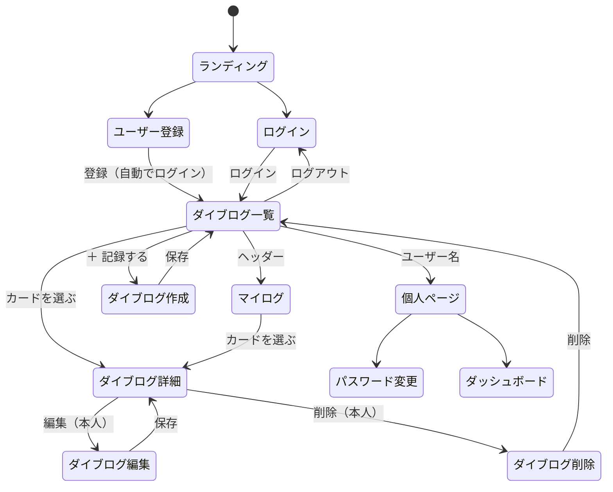

# DEEPLOG 要件定義書

> **要約**
> - スキューバダイビングの**ダイブログ（潜水記録）を記録・整理・振り返る** Web アプリ。1 本ごとに水深・潜水時間・水温・透明度・タンク残圧・見た魚・写真・利用したダイビングショップを記録できる。
> - 自分のログは条件で絞り込み・並び替えができ、ダッシュボードで本数の推移・潜った場所の地図・見た魚のワードクラウドなどを見て、経験を振り返れる。
> - 写真から AI（Gemini）で魚の名前を識別して入力を助け、ダイビングショップは地図（OpenStreetMap）から検索して選べる。

- 公開 URL：https://deeplog-app.onrender.com/
- 関連文書：[設計書](design.md)

---

## 1. 背景と目的

### 1.1 背景

ダイバーは潜るたびにログブックへ記録を残すが、紙のログブックや表計算ソフトでは次のことがしにくい。

- 「透明度が 20m 以上だったダイブ」「水温が低かったダイブ」のように、**条件で探す**こと
- 本数・水深・水温などが**どう変わってきたか**を見ること
- 写真・見た魚・利用したショップなど、**数値以外の記録をまとめて振り返る**こと

### 1.2 目的

1 本ごとのダイブログを Web 上に記録し、**条件で探せる・グラフや地図で振り返れる**ようにする。あわせて、写真からの魚の識別と、地図からのショップの選択で、記録の手間を減らす。

## 2. 想定ユーザーと利用シーン

| ユーザー | 利用シーン | 主に使う機能 |
| --- | --- | --- |
| 本数を重ねている途中のファンダイバー | 潜った日の夜に、ダイブコンピューターの値（水深・時間・水温）と残圧を記録する。次のランクに向けて、通算本数や最大水深の推移を確認する | ログの記録、通算本数、ダッシュボード（推移グラフ・月別本数） |
| 水中写真を撮るダイバー | 撮った写真を複数枚まとめて登録し、AI の候補から見た魚を入力する。「ウミガメを見たダイブ」を検索し、よく見た魚をワードクラウドで振り返る | 写真のアップロード、魚の識別、キーワード検索、ワードクラウド |
| いろいろな海に行くダイバー | 利用したショップを地図から選んで記録する。次の旅行先を考えるときに、過去に潜った場所とショップを地図で見返す | ショップの地図検索、一覧カードの地図、潜った場所の地図 |

## 3. スコープ

### 3.1 対象とする範囲

- ログインしたユーザー本人のダイブログの記録・編集・削除
- 全ユーザーのダイブログの閲覧（一覧と詳細は公開）
- 自分のダイブログの検索・絞り込み・並び替えと、ダッシュボードでの分析

### 3.2 対象外とする範囲

| 機能 | 扱い | 理由 |
| --- | --- | --- |
| お気に入り・コメント・フォローなどの SNS 機能 | 実装しない | 記録と振り返りに絞った。お気に入りは途中まで作成したが、現在は無効にしている |
| ダイブコンピューターからの取り込み | 実装しない | 機種ごとにデータ形式が異なるため。値は手入力する |
| ダイブポイントの位置の登録 | 実装しない | 位置は、利用したダイビングショップの場所で代用する |
| 公開範囲の設定（非公開ログ） | 実装しない | 一覧と詳細は全員に公開する |
| 英語などへの多言語対応 | 実装しない | 画面は日本語のみ |

## 4. 機能要件

### 4.1 機能一覧

| ID | 分類 | 機能 | 概要 |
| --- | --- | --- | --- |
| FR-01 | アカウント | ユーザー登録 | ユーザー名・メールアドレス・パスワードで登録する |
| FR-02 | アカウント | ログイン・ログアウト | メールアドレスとパスワードでログインする |
| FR-03 | アカウント | プロフィール変更 | ユーザー名とメールアドレスを変更する |
| FR-04 | アカウント | パスワード変更 | 今のパスワードを確認してから変更する |
| FR-05 | ログ | 作成 | ダイブログを記録する |
| FR-06 | ログ | 編集・削除 | 自分のダイブログを編集・削除する |
| FR-07 | ログ | 一覧 | 全ユーザーのダイブログをカードで一覧表示する |
| FR-08 | ログ | 詳細 | 1 本のダイブログのすべての項目を表示する |
| FR-09 | ログ | 通算本数 | 何本目のダイブかを自動で計算して表示する |
| FR-10 | マイログ | キーワード検索 | 場所・ポイント名・魚・バディ・インストラクター・自由記述から探す |
| FR-11 | マイログ | 絞り込み | 日付・選択項目・数値の範囲で絞り込む |
| FR-12 | マイログ | 並び替え | 6 つの項目の昇順・降順で並び替える |
| FR-13 | 写真 | アップロード | 1 つのログに写真を複数枚登録・削除する |
| FR-14 | 写真 | 閲覧 | 詳細画面で写真を切り替えて見る |
| FR-15 | 写真 | 魚の識別 | 写真から AI で魚の名前を識別し、「発見できた魚」に追加する |
| FR-16 | ショップ | 地図から選択 | 利用したダイビングショップを地図で検索して選ぶ |
| FR-17 | ショップ | 地図の表示 | 一覧のカードと詳細画面に、ショップの地図を表示する |
| FR-18 | ダッシュボード | 数値サマリー | 通算本数・合計潜水時間・過去最大深度・過去最大平均深度 |
| FR-19 | ダッシュボード | 月別潜水本数 | 月ごとの本数の棒グラフ |
| FR-20 | ダッシュボード | ダイブ目的の内訳 | 目的ごとの本数のドーナツグラフ |
| FR-21 | ダッシュボード | 潜った場所 | 潜った場所を地図に表示する |
| FR-22 | ダッシュボード | 発見できた魚 | 見た魚のワードクラウド |
| FR-23 | ダッシュボード | 推移グラフ | タンク残圧・深度・潜水時間・水底温度の推移 |
| FR-24 | ダッシュボード | 透明度の推移 | 透明度の推移の折れ線グラフ |

### 4.2 アカウント（FR-01〜04）

| ID | 要件 |
| --- | --- |
| FR-01 | ユーザー名・メールアドレス・パスワード（確認用を含め 2 回）を入力する。メールアドレスは大文字・小文字を区別せず重複を許さない。パスワードは Django 標準の検査（短すぎる・よくある・数字だけ・ユーザー名と似ている）に通るものとする。登録後は自動でログインし、ダイブログ一覧に移る |
| FR-02 | ログインはメールアドレスとパスワードで行う（ユーザー名では入れない）。ログイン後はダイブログ一覧に移る。ログアウト後はログイン画面に移る。ログイン中にログイン画面を開いた場合は一覧に移る |
| FR-03 | 個人ページで、ユーザー名とメールアドレスを変更する。変更後は新しいメールアドレスでログインする |
| FR-04 | 今のパスワードと新しいパスワード（2 回）を入力して変更する。変更後もログインしたままにする |

### 4.3 ダイブログ（FR-05〜09）

**記録する項目**

| 分類 | 項目 | 必須 | 入力形式 |
| --- | --- | --- | --- |
| 場所 | 潜水日付・場所・ポイント名 | 潜水日付のみ必須 | 日付・テキスト |
| 場所 | 利用したダイビングショップ | 任意 | 地図で選ぶ（FR-16） |
| ダイブ | エントリー方法（ビーチ / ボート）・ダイブ目的（ファン / 撮影 / 講習） | 必須 | 選択 |
| ダイブ | エントリー日時・エキジット日時 | 必須 | 日時 |
| 器材 | 潜水開始時・終了時のタンク圧力、タンク種別（スチール / アルミ）、ウェイト重量 | 必須 | 数値・選択 |
| 器材 | スーツ種別（ウェット 5mm 以下 / 5mm / 6.5mm / ドライ） | 任意 | 選択 |
| 環境 | 流れの強さ・天気・波の高さ・風の強さ | 必須 | 選択 |
| 環境 | 気温・水面温度・水底温度・透明度 | 必須 | 数値 |
| 記録 | 平均水深・最大水深 | 必須 | 数値（m） |
| 記録 | 写真（FR-13）・発見できた魚・自由記述・バディ名・インストラクター名 | 任意 | 画像・テキスト |

| ID | 要件 |
| --- | --- |
| FR-05 | ログインしているユーザーだけが作成できる。記録者は自動でログイン中のユーザーにする。保存後はダイブログ一覧に移る |
| FR-06 | 編集・削除ができるのは記録者本人だけとする。本人以外が編集・削除の URL を開いた場合は拒否する（403）。削除は確認画面を経て行い、登録した写真も一緒に削除する。編集後は詳細画面に移る |
| FR-07 | 全ユーザーのダイブログを 1 ページ 9 件のカードで表示する。ログインしていなくても見られる。カードには、タイトル画像（FR-17）・場所・通算本数・潜水日付・ポイント名・ダイブ目的・エントリー方法・潜水時間・最大水深・透明度・水面温度を表示する |
| FR-08 | 全項目に加えて、潜水時間（エキジット日時 − エントリー日時、分）・写真（FR-14）・ショップ（FR-17）・記録者を表示する。ログインしていなくても見られる。記録者本人には編集・削除ボタンを表示する |
| FR-09 | 同じユーザーのログを、エントリー日時の古い順に数えた番号を「Dive No.」として一覧と詳細に表示する。値は保存せず、表示のたびに計算する |

### 4.4 マイログ（FR-10〜12）

ヘッダーの「マイログ」から、ログイン中のユーザーのダイブログだけを表示する。検索・絞り込み・並び替えはマイログでだけ使える。

| ID | 要件 |
| --- | --- |
| FR-10 | 1 つのキーワードで、場所・ポイント名・発見できた魚・バディ名・インストラクター名・自由記述のどれかに含まれるログを探す（部分一致） |
| FR-11 | 次の条件で絞り込む。すべて任意で、複数を指定したときはすべてを満たすもの（AND 条件）にする。 ・潜水日付（から・まで） ・エントリー方法・ダイブ目的・天気・流れの強さ・タンク種別・スーツ種別（選択） ・最大水深・水底温度・透明度（下限〜上限）、潜水時間（下限） 数値の 0 も条件として扱う（例：最大水深の上限 0）。水温はマイナスも指定できる。条件を指定しているときは「適用中」と表示し、条件をクリアするボタンを出す |
| FR-12 | 潜水日付・潜水時間・最大水深・透明度・タンク残圧（開始時 − 終了時）・水底温度のいずれかで、大きい順（初期値）か小さい順に並べる。初期値は潜水日付の新しい順。同じ値のログは新しく登録した順に並べる。並び替えを変えたら自動で再表示し、絞り込みの条件は残す。ページを移っても、検索・絞り込み・並び替えの条件を残す |

### 4.5 写真（FR-13〜15）

| ID | 要件 |
| --- | --- |
| FR-13 | 画像（JPEG・PNG・WebP など）を、1 枚 10MB まで、1 つのログに合計 10 枚まで登録する。複数枚をまとめて選べ、選んだ写真はサムネイルで確認し、1 枚ずつ外せる。編集画面では登録済みの写真に「削除」のチェックを付けて削除する。合計枚数は「残す登録済みの写真 ＋ 追加する写真」で数える |
| FR-14 | 詳細画面で、1 枚目を大きく表示し、下のサムネイルで切り替える。何枚目かを「2 / 3」のように表示し、クリックすると元のサイズで開く。一覧のカードでは、ショップの地図がないときに 1 枚目をタイトル画像にする |
| FR-15 | 投稿・編集画面で新しく選んだ写真を、最大 10 枚まで 1 枚ずつ AI に送り、写っている魚・海の生物の和名を候補として表示する。候補を押すと「発見できた魚」に**半角スペース区切り**で追加する（すでに入っている名前は追加しない）。「すべて追加」でまとめて追加できる。AI の結果は自動では保存せず、ユーザーが選ぶ |

### 4.6 ダイビングショップ（FR-16〜17）

| ID | 要件 |
| --- | --- |
| FR-16 | 投稿・編集画面の地図で、次の 3 つの方法でショップを選ぶ。 ① ショップ名・地名で検索して、候補の一覧か地図の印から選ぶ ② 「この範囲のダイビングショップを探す」で、表示中の地図の範囲にあるショップを探す（地図を一定以上拡大しているときだけ） ③ 候補にないときは、地図をクリックして場所を指定し、ショップ名を手入力する 選ぶと、ショップ名・住所・緯度・経度が入る。ショップ名は選んだ後に手で直せる。「選択を外す」で解除できる |
| FR-17 | ショップの場所が登録されたログでは、一覧のカードのタイトル画像をショップの地図にし、ショップ名を重ねて表示する（地図は操作できず、クリックで詳細へ）。写真があれば枚数も表示する。詳細画面には、ショップ名・住所・操作できる地図と、OpenStreetMap で大きな地図を開くリンクを表示する |

### 4.7 ダッシュボード（FR-18〜24）

個人ページの「潜水ログ可視化ダッシュボード」から開く。ログイン中のユーザーのダイブログだけを集計する。

| ID | 要件 |
| --- | --- |
| FR-18 | 通算本数・合計潜水時間（分）・過去最大深度・過去最大平均深度を表示する |
| FR-19 | 最初に潜った月から最後に潜った月まで、**潜らなかった月も 0 本として**表示する |
| FR-20 | ダイブ目的ごとの本数を、画面表示用の名前（ファンダイビング・撮影・講習）で表示する |
| FR-21 | 潜った場所（ログの「場所」）ごとに 1 つの印を、利用したショップの位置に表示する。本数が多いほど印を大きくし、押すと本数・最後に潜った日・ポイント・ショップを表示する。ショップの場所がないログの本数は、説明文に表示する |
| FR-22 | 「発見できた魚」を名前ごとに数え（半角・全角スペース、カンマ、読点のどれで区切っていても分ける）、多く見た魚ほど大きく表示する（最大 80 種類）。文字にマウスを乗せると回数を表示する。上位 5 種類を文字でも表示する |
| FR-23 | 潜った順に 1 本ずつ、タンク残圧（棒）・最大深度・平均深度・潜水時間・水底温度（折れ線）を表示する。単位ごとに縦軸を分ける。凡例を押すと項目ごとに表示・非表示を切り替える |
| FR-24 | 潜った順に 1 本ずつ、透明度を折れ線で表示する |

FR-23・FR-24 の横軸は、上の段に**日**（01・10・21）、下の段に**年/月**（2026/8）を表示する 2 段にし、月の境目に縦線を引く。画面が狭く 1 本あたりの幅が足りないときは、グラフを横にスクロールできるようにし、最初は最新のダイブが見える右端を表示する。

### 4.8 異常時の動作

| 状況 | 動作 |
| --- | --- |
| ログインせずに作成・編集・ダッシュボードを開いた | ログイン画面に移る |
| 本人以外が編集・削除を開いた | 403 を返す |
| 必須項目の未入力・形式の誤り | 入力欄の下にエラーを表示し、入力内容を残す |
| 写真が 10MB を超える・画像ではない | 選んだ時点で知らせて選択から外す（サーバー側でも拒否する） |
| 写真が合計 10 枚を超える | エラーを表示して送信しない（サーバー側でも拒否する） |
| ショップの緯度・経度の片方だけ、または範囲外 | 「地図でもう一度選んでください」と表示する |
| 場所を指定したのにショップ名が空 | ショップ名の入力を求める |
| 絞り込みに不正な値（数値欄に文字など） | 絞り込みをかけずに全件を表示する |
| 条件に合うマイログが 0 件 | 「条件に一致するダイブログはありません」と表示する |
| 魚の識別で AI の利用上限に達した | 上限に達したことを表示し、残りの写真は送らない。そこまでに見つかった候補は表示する |
| 魚の識別で AI が失敗した・通信に失敗した | 失敗したことを表示し、手入力を案内する |
| 魚が見つからなかった | 「魚を見つけられませんでした」と表示する |
| ショップの検索が見つからない・失敗した・時間がかかりすぎた | 理由と、ほかの探し方（名前検索・地図のクリック）を案内する |
| ダイブログが 0 件でダッシュボードを開いた | 記録を始めるボタンを表示する |
| ダッシュボードで表示できるデータがない項目 | その項目に「データがありません」などと表示する |

## 5. 画面要件

### 5.1 画面一覧と遷移

| 画面 | URL | ログイン | 内容 |
| --- | --- | --- | --- |
| ランディング | `/` | 不要 | アプリの紹介・ログイン・新規登録。ログイン中は一覧に移る |
| ユーザー登録 | `/accounts/register/` | 不要 | 登録フォーム |
| ログイン | `/accounts/login/` | 不要 | ログインフォーム |
| ダイブログ一覧 | `/logs/` | 不要 | 全ユーザーのダイブログ |
| マイログ | `/logs/?mine=1` | 必要 | 自分のダイブログ・検索・絞り込み・並び替え |
| ダイブログ詳細 | `/logs/<id>/` | 不要 | 1 本の全項目・写真・ショップ |
| ダイブログ作成 | `/logs/new/` | 必要 | 入力フォーム・写真・魚の識別・ショップの地図 |
| ダイブログ編集 | `/logs/<id>/edit/` | 本人のみ | 作成と同じフォーム |
| ダイブログ削除 | `/logs/<id>/delete/` | 本人のみ | 削除の確認 |
| 個人ページ | `/accounts/profile/` | 必要 | プロフィール変更・パスワード変更・ダッシュボードへのリンク |
| パスワード変更 | `/accounts/password_change/` | 必要 | パスワード変更フォーム |
| ダッシュボード | `/dashboard/` | 必要 | 自分のダイブログの分析 |

### 5.2 レイアウト

| 画面幅 | 内容 |
| --- | --- |
| PC | 一覧のカードは複数列。ダッシュボードはグラフを 2 列に並べ、地図・ワードクラウド・推移グラフは横幅いっぱいに表示する |
| スマホ（375px で確認） | カード・グラフは 1 列。ページ全体は横にはみ出さず、横に長い推移グラフだけをカードの中で横スクロールする |

## 6. 非機能要件

### 6.1 性能・応答性

| 項目 | 要件 |
| --- | --- |
| 一覧の表示 | カードの写真は、ページ単位でまとめて読み込む（ログごとに問い合わせない） |
| 一覧の地図 | カードの地図は、画面に入ったときに作る（1 ページ 9 枚の地図を一度に作らない） |
| 地図の読み込み | 地図のライブラリは、地図を使う画面（一覧・詳細・作成・編集・ダッシュボード）でだけ読み込む |
| ショップの範囲検索 | 外部サービスが混雑していても待ち続けないよう、70 秒で打ち切る |
| 魚の識別 | 写真は 1 枚ずつ順番に送り、AI の 1 分あたりの利用上限にかかりにくくする |

### 6.2 セキュリティ

| 項目 | 要件 |
| --- | --- |
| 認証 | 作成・編集・削除・マイログ・ダッシュボード・魚の識別はログインを必須にする |
| 権限 | 編集・削除は記録者本人だけ。写真の削除も、そのログの写真に限る |
| CSRF | フォームの送信と魚の識別の送信に CSRF トークンを付ける |
| API キーの保護 | Gemini の API キーと Django の SECRET_KEY はサーバーの環境変数にだけ置き、リポジトリやブラウザには含めない |
| 入力値の検証 | 画面での確認に加えて、サーバー側でも全項目（写真の種類・サイズ・枚数、緯度・経度の範囲、絞り込みの値）を検証する |
| 外部データの表示 | AI の結果・ショップ名・地名など外部から取得した文字列は HTML として解釈させない |
| 外部ライブラリ | CDN から読み込むライブラリはバージョンを固定する（Leaflet と wordcloud2.js は改ざん検知（SRI）付き） |

### 6.3 外部サービスの利用条件

| サービス | 守る条件 |
| --- | --- |
| Google Gemini API（無料枠） | 1 分・1 日あたりの利用上限がある（上限は AI Studio で確認する）。無料枠に送ったデータは、Google のサービス改善に使われることがある |
| OpenStreetMap（地図タイル） | 地図に著作権表示を出す。サイトのオリジン（Referer）を送る（送らないと 403 になる） |
| Nominatim（名前検索・住所の取得） | 1 秒に 1 回まで。入力中の自動補完には使わない（ボタンか Enter で検索する） |
| Overpass API（範囲内のショップ検索） | 公開サーバーを低頻度で使う。広すぎる範囲は検索しない |

### 6.4 可用性

| 項目 | 内容 |
| --- | --- |
| 公開環境 | Render の無料プランのため、15 分ほど使われないと停止し、次に開いたときの表示に 30〜50 秒ほどかかる |
| 写真の保存 | 公開環境ではサーバーのディスクに保存するため、再デプロイや停止のたびに消える（[8. 今後の課題](#8-今後の課題)） |
| 外部サービスの停止 | 魚の識別やショップの検索が使えなくても、ログの記録は手入力でできる |

### 6.5 対応環境

| 項目 | 内容 |
| --- | --- |
| 動作確認済み | Chrome（Windows PC） |
| 画面幅 | PC とスマホ（375px）の両方に対応する |

### 6.6 アクセシビリティ

- 入力欄にラベルを付け、地図・グラフ・ボタンに読み上げ用のラベルを付ける。
- ショップの検索結果などの状態の変化を、読み上げソフトに通知する。

## 7. データについての制約

| 項目 | 制約 |
| --- | --- |
| 潜水時間 | エントリー日時とエキジット日時の差（分）として計算する。保存はしない |
| 通算本数 | 同じユーザーのログを、エントリー日時の古い順に数える。過去のログを後から追加すると、それ以降の番号が変わる |
| 潜った場所の位置 | ダイブポイントの位置は持たないため、利用したショップの位置で代用する。ショップがポイントから離れている場合は、地図の印も離れる |
| 発見できた魚 | 1 つの文字列として保存する。ワードクラウドでは、スペース・カンマ・読点で分けて数える。表記ゆれ（例：ウミガメとアオウミガメ）は別の魚として数える |
| 魚の識別の精度 | 有名な魚（マンタ・ウミガメなど）は当たりやすいが、小さなハゼ・ウミウシ・似た種の多い魚は間違えやすい |
| ショップのデータ | OpenStreetMap に登録されているショップしか検索できない。地域によって登録数に差がある（確認では、沖縄県恩納村周辺で 50 件見つかったが、北海道羅臼周辺は 0 件だった）。閉店・移転した店が残っていることもある |
| 写真 | 1 枚 10MB・1 つのログに 10 枚まで |

## 8. 今後の課題

| 課題 | 内容 |
| --- | --- |
| 公開環境での写真の保存と配信 | Render の無料プランではアップロードした写真が消える。また、アップロードした写真を Django が配信するのは `DEBUG=True` のときだけなので、公開環境（`DEBUG=False`）では写真が表示されない。外部のストレージ（Cloudinary・Amazon S3 など）に保存・配信する必要がある |
| 自動テスト | 自動テストがなく、動作確認は手動で行っている |
| ダイブポイントの位置 | ポイントの位置を記録できないため、潜った場所の地図はショップの位置で代用している |
| 魚の名前の表記ゆれ | 同じ魚が別の名前で数えられる。候補から選ぶ形式や、名前の辞書が必要 |
| 一覧の通算本数の計算 | 通算本数をカードごとに計算するため、1 ページにつきログの件数分の問い合わせが発生する |
| 旧画面の名残 | ランディング画面の「お気に入り登録」の説明や、詳細画面の旧項目への参照など、無効にした機能の名残がある |
